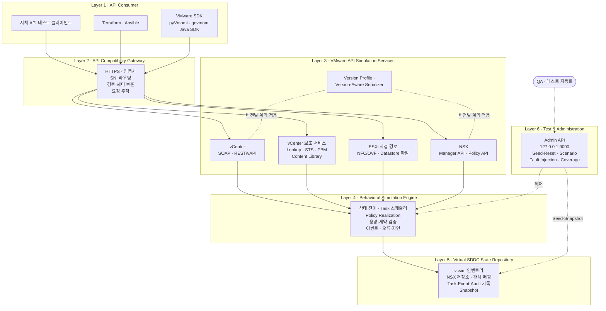

# CloudInfra Simulator
## 목표 아키텍처 상세 명세서 / AI 에이전트 분석 및 개발계획 수립 지침

**부제:** CMP-Oriented VMware SDDC API Simulator  
**저장소:** `cloudinfra-sim`  
**문서 버전:** 1.1 (개정 이력: `../PRD-revision.md`)  
**프로젝트 유형:** API Compatibility Simulator / Stateful Behavioral Emulator  
**주요 기술:** Go (govmomi/vcsim 임베드, 단일 바이너리), SQLite, Python(테스트 도구), (선택) Docker  
**목표 사용자:** VMware vCenter 및 NSX Manager를 연동하는 CMP 개발·QA 조직

---

## 목차

1. 프로젝트 목적
2. 전체 시스템 아키텍처
- 세부 요구사항 문서 (3~19장)

---

# 1. 프로젝트 목적

## 1.1 최종 목표

실제 VMware 인프라(vCenter Server, ESXi, NSX Manager)를 설치하거나 연결하지 않고 VMware API와 상태 동작을 구성하고, 프로젝트 내부의 테스트 클라이언트로 검증할 수 있는 API Simulator를 개발한다. CMP 문서는 범위 선정의 참고 자료로만 사용한다(D13).

본 프로젝트에서 '시뮬레이션'이란 실제 가상머신이나 네트워크를 실행하는 것이 아니라, VMware API를 통해 관찰되는 객체, 상태, 작업, 이벤트, 오류, 응답 시간을 소프트웨어적으로 재현하는 것을 의미한다.

최종 목표는 다음과 같다.

1. 공개된 VMware API 계약에 맞는 인터페이스를 제공하고 자체 테스트 클라이언트로 검증한다.
2. 승인된 시뮬레이션 범위의 vCenter SOAP 및 REST API를 지원한다.
3. 승인된 시뮬레이션 범위의 NSX Manager 및 Policy API를 지원한다.
4. API 호출에 따른 상태 변화와 리소스 관계가 실제 VMware 제품의 동작 계약에 부합해야 한다.
5. 가상의 VM, Host, Cluster, Datastore, Network 및 NSX 리소스를 생성·변경·삭제·조회할 수 있어야 한다.
6. 인증, 인가, 세션, 비동기 작업, 이벤트, 동시성, 충돌 및 장애 동작을 재현할 수 있어야 한다.
7. 재현 가능한 테스트 환경을 생성하고 초기화할 수 있어야 한다.
8. 개발자 개인 PC에서 경량으로 실행할 수 있어야 한다.
9. 새로운 API와 VMware 버전을 확장할 수 있어야 한다.
10. 시뮬레이터의 정상·예외 시나리오에 대한 자동화된 자체 회귀 테스트를 지원한다.

위 목표 중 다음 두 가지를 **핵심 목표**로 지정하며, 설계 선택이 충돌할 경우 이 두 목표를 우선한다.

- **핵심 목표 A:** vCenter 및 NSX 버전을 지정하면 승인된 시뮬레이션 범위에서 해당 버전의 API 계약과 상태 동작을 재현하고 자체 테스트로 검증한다.
- **핵심 목표 B:** 개인 PC에서 동작하도록 실행 구성 요소와 리소스 사용을 최소화한다.

## 1.2 호환성의 정의

'완벽하게 동일한 동작'은 VMware 전체 기능의 복제를 뜻하지 않는다.

다음 조건을 모두 만족하는 것을 프로젝트의 목표 호환성으로 정의한다.

- 사전에 승인한 시뮬레이션 API 및 자체 시나리오 범위에서 API 요청·응답이 지정 VMware 버전의 계약과 일치한다.
- API로 관찰되는 논리적 상태와 객체 관계가 일관성을 유지한다.
- 여러 API를 연속적으로 호출했을 때 기대되는 상태 변화가 발생한다.
- 비동기 작업과 이벤트 감시가 자체 테스트에 정의한 계약상 대기·완료 조건을 충족한다.
- 오류·재시도·롤백 경로가 테스트 가능하다.
- 인증·권한·버전 관련 동작이 승인된 시뮬레이션 범위 내에서 호환된다.

정확성은 단순한 HTTP 성공 코드가 아닌, API 계약과 시나리오 기반 테스트로 입증한다.

**대상 제품 버전 (D1, 2026-10-10):** vSphere/vCenter 7.0 U2 이상(8.x 포함), NSX-T 3.x(Policy API 기반, NSX 4.x 전용 기능 미사용). vSphere 9(VCF 9 계열)는 현재 범위에 포함하지 않는다. vSphere 8.x와 조합할 수 있는 NSX-T는 3.2.x 일부 빌드로 제한되므로(VMware 상호운용성 매트릭스로 확인), 허용 조합은 `compatibility-matrix.yaml`(FR-API-0305)로 관리한다. **첫 기준 조합은 vCenter 7.0 U3w(7.0.3.02500, 빌드 24927011) + NSX-T 3.2.4.3(빌드 24942842)**이다(선정된 기준 패치). 공식 스펙(WP 0.6)의 대상 버전·빌드와 출처를 기록한다. NSX 계약 근거는 Broadcom이 공개한 최신 3.2 계열 공식 스펙인 NSX-T 3.2.1(3.2.1.0.0) Manager·Policy OpenAPI로 한다. 3.2.4.x 스펙은 공개되지 않았으므로 3.2.4.3 프로파일에 3.2.1 스펙을 적용하고, 두 빌드 간 차이는 '미검증'으로 표시하며 3.2.2 ~ 3.2.4.3 릴리스 노트의 API 변경 사항으로 보완한다(FR-API-0309, 2026-10-10 결정). 실환경 Trace 수집은 현재 범위 밖이며(D5·D13), 같은 빌드의 실제 동작을 검증했다는 의미로 해석하지 않는다.

승인된 시뮬레이션 범위는 공식 스펙·문서와 CMP 기능 참고 목록에서 선정한다. Phase 0b에 자체 테스트 SDK·버전, API·필드·행위·오류·시나리오의 잠정 범위를 기록하고(D2), Phase 2b에서 MVP 범위를 확정한다. CMP 소스 분석이나 실제 CMP 실행·호출 수집은 수행하지 않는다. 자체 테스트에서 관찰하지 못한 API는 '미관찰/미검증'으로 남기고, 명시적 범위 결정 없이 '미사용'으로 제외하지 않는다.

실제 제품에서 검증하지 못한 동작은 '검증 완료'로 표시하지 않는다.

## 1.3 범위에서 제외할 항목

현재 프로젝트 범위에서 다음은 구현·검증하지 않는다.

- CMP 소스 분석, 실제 CMP 연결·등록·상품 Workflow 검증
- CMP 상품별 할당량·과금·약정·신청 제한·콘솔 상태·승인 절차
- 실제 VMware 연동 시험, 실환경 Trace 수집·Record 모드 및 실환경 Differential Test(향후 보류: D5·D13)

- 실제 ESXi 하이퍼바이저
- 실제 가상머신 및 Guest OS 실행
- 실제 vCenter Appliance
- 실제 NSX Manager Appliance
- 실제 NSX Edge, TEP, Overlay 및 데이터플레인
- 실제 L2/L3 패킷 전달
- 실제 분산 방화벽 패킷 처리
- EVE-NG, GNS3, Containerlab 등의 네트워크 에뮬레이터
- 실제 스토리지 볼륨 및 VMDK 데이터 저장
- 실제 VM 이미지의 전송·부팅
- 실제 물리 장비 제어

다만 위 기능의 API 관찰 결과는 필요한 범위에서 가상 상태로 표현할 수 있다.

예를 들어 VM을 Power On하면 Guest OS를 실행하는 대신 해당 VM의 API 전원 상태를 `poweredOn`으로 변경한다. Guest IP나 VMware Tools 상태가 필요한 경우에는 테스트 데이터와 상태 전이 규칙에 따라 가상 값을 제공한다.

파일 업로드, 템플릿 배포 등 실제 바이너리 전송을 동반하는 기능은 선정한 VMware API 계약 수준에서 별도 지원 여부를 결정한다.

단, OVF 배포·Content Library 배포는 시뮬레이션할 VM 프로비저닝 방식에 영향을 주므로 '나중 결정' 대상이 아니라 **MVP 포함 여부를 Phase 0에서 결정할 항목**으로 지정한다(§19). 지원할 경우 실제 디스크 데이터는 저장하지 않고, 업로드 스트림은 수신 후 폐기하며 크기·진행률·완료 상태만 모델링한다.

## 1.4 핵심 설계 원칙

1. **Version-First:** 버전 프로파일은 나중에 추가하는 기능이 아니라 시스템의 입력 축이다. 직렬화·스키마 검증·엔드포인트·행위 규칙은 모두 활성 프로파일에서 결정된다. MVP는 한 개 버전만 채워도 되지만 프로파일 골격은 Phase 1부터 존재해야 한다.
2. **Spec-Driven:** 버전별 계약은 손으로 옮겨 적지 않고 공식 산출물(vSphere WSDL/타입 메타데이터, vSphere Automation 및 NSX OpenAPI 스펙)을 데이터로 로드해 사용한다.
3. **In-Path Behavior:** 요청을 거부·변형해야 하는 행위 로직(사전조건, 용량 검증, 의미적 Fault)은 요청 처리 경로 안에서 동기적으로 실행한다. 사후 Reconciliation으로 요청 거부를 대신하지 않는다.
4. **Single Source of Truth In-Process:** vCenter와 NSX 상태는 가능한 한 하나의 프로세스 메모리 안에서 관리하여 교차 시스템 일관성을 프로세스 간 동기화 없이 보장한다.
5. **Budgeted Footprint:** 리소스 예산(§13.1)은 완료 기준이며, CI에서 회귀를 감시한다.
6. **Native-First:** Docker 없는 네이티브 실행을 기본 배포 방식으로 한다. D3에서 권고안 A(단일 Go 실행파일)를 채택했으며, 대안인 권고안 B(Go + Python 2 프로세스)와 그 재검토 조건은 PRD-B에 분리해 두었다. Docker는 CI·선택 실행 수단이다.

본 문서에 기술한 vcsim·NSX의 구체적 동작(확장 지점, 버전 필터링 여부, 시계 처리 등)은 공식 저장소·문서로 확인하기 전까지 '추정'으로 취급하며, Phase 0 PoC에서 검증한다.

---

# 2. 전체 시스템 아키텍처

## 2.1 아키텍처 개요

시스템은 6개의 논리 계층으로 구성한다.

그림의 실선은 자체 테스트 요청 경로, 점선은 관리·제어 경로이다. 자체 테스트 클라이언트는 `https://*.cloudinfra-sim.test`(443)로 Gateway에만 접근하며, Admin API(Layer 6)는 루프백 주소로만 열려 VMware API 클라이언트에 노출되지 않는다.

위 계층은 **논리 계층**이며 프로세스 경계를 의미하지 않는다. 물리 배치는 PRD-3 §14.1(프로세스 구성안 비교)과 §14.3(프로세스 및 네트워크 구성)을 따른다. 특히 Layer 4의 행위 로직 중 요청 거부·변형이 필요한 부분은 Layer 3과 같은 프로세스에서 동기 실행한다.

**계층별 구성 요소**

| 계층 | 구성 요소 |
|---|---|
| Layer 1 — API Consumer | 자체 API 테스트 클라이언트, VMware SDK, 선택한 자동화 테스트 도구 |
| Layer 2 — API Compatibility Gateway | HTTPS 및 인증서 처리, 도메인 기반 라우팅, API 경로 및 헤더 전달, 실제 VMware 응답 계약 보존, 요청 추적, 내부 관리자 API 분리 |
| Layer 3 — VMware API Simulation Services | vCenter SOAP API Engine, vCenter REST/vAPI Engine, vCenter 보조 서비스(Lookup Service, STS(SSO), PBM, Content Library/OVF), ESXi Host 직접 접속 엔드포인트(NFC/OVF 업로드, Datastore 파일 접근), NSX Manager API Engine, NSX Policy API Engine(Hierarchical API 포함), Version Profile & Version-Aware Serializer |
| Layer 4 — Behavioral Simulation Engine | 논리적 인프라 상태 모델, 리소스 상태 전이, 작업 스케줄러, 이벤트 및 알람 생성, Policy Realization 처리, API 간 관계 동기화, 용량 및 배치 제약조건, 오류 및 지연 시뮬레이션 |
| Layer 5 — Virtual SDDC State Repository | vCenter 시뮬레이터 인벤토리, NSX 리소스 저장소, Cross-System Resource Mapping, Task 및 Operation 기록, Event 및 Audit Log, 테스트 환경 Snapshot, 시나리오 정의와 설정 |
| Layer 6 — Test & Administration | 환경 Seed 및 Reset, Scenario Runner, Fault Injection, API Coverage 검증, Contract Test, Test Report |

## 2.2 외부 연결 구조

자체 테스트 클라이언트가 접근하는 엔드포인트는 다음처럼 구성한다.

| 논리적 서비스 | 예시 주소 | 기본 바인딩 | 외부 포트 |
|---|---|---|---|
| vCenter | https://vcenter.cloudinfra-sim.test | 127.0.0.2 | 443 |
| NSX Manager | https://nsx.cloudinfra-sim.test | 127.0.0.3 | 443 |
| ESXi Host (가상) | https://esx-01.cloudinfra-sim.test 등 | 127.0.0.2 (SNI 라우팅) | 443 |
| Simulator Admin API | http://127.0.0.1:9000 | 127.0.0.1 | 9000 |

**가상 호스트 도메인:** 기본 도메인은 `cloudinfra-sim.test`이며, 각 서비스의 호스트 이름은 `<서비스>.<도메인>` 형식(`vcenter`, `nsx`, `esx-NN`)을 따른다. 도메인은 `--domain` 옵션 또는 `SIM_DOMAIN` 환경변수로 바꿀 수 있다(PRD-3 NFR-0313, NFR-0314).
- `.test`는 테스트 전용 예약 TLD(RFC 2606, RFC 6761)로 공용 DNS에서 해석되지 않으므로 실제 운영 VMware와 혼동되지 않는다.
- mDNS 전용 TLD인 `.local`은 이름 해석 지연·hosts 설정 무시 문제가 있어 사용하지 않는다.
- 팀 공용 서버에 내부 DNS를 두는 구성(PRD-3 NFR-ARC-0309의 배포 토폴로지 3)에서는 사내 전용 예약 TLD인 `.internal`(예: `cloudinfra-sim.internal`)을 사용할 수 있다.

Admin API는 VMware API와 분리하므로 호스트 이름을 부여하지 않고 루프백 주소로만 접근한다.

프로세스 구성, Gateway 라우팅 경로, 관리 API 분리, 포트·바인딩, 로컬 네트워크 설정, 지원 배포 토폴로지 등 세부 요구사항은 PRD-3 §14.3(NFR-ARC-0301 ~ NFR-ARC-0309)을 따른다.

---

# 세부 요구사항 문서

3~19장은 다음 4개 문서로 분리해 관리한다. PRD-1~3은 요구사항 명세이고, PRD-4는 그 요구사항을 구현하기 위한 개발계획 기준선이다. 채택하지 않은 권고안 B의 설계는 PRD-B로 분리했으며, 본문은 필요한 지점에서 PRD-B를 참조한다. 본문의 `§n` 참조(예: §13.1, §14.1, §19)는 아래 문서의 같은 번호에서 찾으며, 구체적인 의무는 요구사항 ID로 함께 참조한다.

| 문서 | 포함 장 | 요구사항 ID 접두어 / 식별자 | 요구사항 수 |
|---|---|---|---:|
| `cloudinfra-sim-PRD-1-기능별-요구사항.md` | 3. vCenter API Simulation Engine 4. NSX API Simulation Engine 5. Behavioral Simulation Engine 6. Virtual SDDC 데이터 모델 7. API Compatibility Layer 8. 오류 및 장애 재현 9. 가상 메트릭·이벤트·알람 | FR-VC, FR-NSX, FR-BE, FR-DM, FR-API, FR-FLT, FR-MET | 278 |
| `cloudinfra-sim-PRD-2-테스트-요구사항.md` | 10. Scenario & Test Controller 11. 필수 End-to-End 테스트 시나리오 12. API Coverage 및 호환성 검증 | TR-SCN, TR-E2E, TR-COV | 82 |
| `cloudinfra-sim-PRD-3-비기능-요구사항.md` | 13. 성능 및 비기능 요구사항 14. 권장 기술 아키텍처 및 디렉터리 구조 | NFR, NFR-ARC | 78 |
| `cloudinfra-sim-PRD-4-개발계획-검토.md` | 15. 개발 우선순위 및 단계 16. 우선 분석해야 할 핵심 기술적 위험 17. 최종 완료 기준 18. AI 에이전트 개발계획 수립 지시 19. 개발 착수 전 결정 필요 사항 | 계획 식별자: WP, R, AC, PoC, D (요구사항 ID 아님) | — |
| `cloudinfra-sim-PRD-B-권고안B-대안-구성.md` | 권고안 B(Go + Python 2 프로세스) 대안 구성, 재검토 조건·전환 절차 (D3에서 A 채택) | 새 ID 없음 (B 전용 ID 행은 PRD-1·3에 '보류'로 유지) | — |
| **합계 (PRD-1~3)** | | | **438** |

다음 2개 문서는 '승인된 시뮬레이션 범위'(D2)를 정하기 위한 참고 자료다. 새 요구사항 ID를 만들지 않으며, 요구사항 수에 포함하지 않는다.

| 문서 | 내용 |
|---|---|
| `cloudinfra-sim-PRD 1.1 CMP 요구기능 목록.md` | 기준 CMP(Samsung Cloud Platform) 매뉴얼에서 추출한 VMware·NSX 관련 기능 150개(`CMP-*` 기능 ID), 기능별 vCenter·NSX API 후보 매핑, PRD-1 대비 미정의 API 영역 |
| `cloudinfra-sim-PRD 1.2 호환성 목표범위.md` | 시뮬레이션 범위 선정, 후보 기능 의존성, 자체 테스트 판정 기준과 외부 검증의 경계 |

## 요구사항 추적 원칙

- **ID 형식:** `접두어-SSNN` (SS = 절·시나리오 번호 2자리, NN = 일련번호 2자리). 한 번 부여한 ID는 변경·재사용하지 않으며, 삭제된 요구사항은 행을 지우지 않고 상태를 '삭제'로 바꾼다.
- **공통 열:** 수준(필수 / 권장 / 선택 / 검토), MVP(● MVP 범위 / ○ §19 결정에 따름 / – MVP 이후 또는 적용 제외), 상태(정의 / 분석 / 설계 / 구현 / 검증 / 완료 / 보류 / 삭제). 상세 기준은 각 문서의 '요구사항 표 작성 기준'에 있다.
- **추적 연결:** 기능·테스트·비기능 요구사항 전체를 `요구사항 ID → 적용 여부/결정 근거 → WP/목표 단계 → 검증 방법/시험 ID → AC → 증거/결과`로 연결한다(TR-COV-0103, PRD-4 §15.5). E2E의 '관련 요구사항' 열은 이 연결의 일부이며, 설계 검토·PoC·Unit·Contract·Negative·무결성·보안·Footprint 시험도 해당 요구사항의 검증 수단이다. 계획과 실제 통과 증거를 구분한다.
- **API 단위 상태:** 개별 API의 구현·검증 상태는 요구사항 표가 아니라 API Coverage Matrix(PRD-2 §12)로 관리한다.
- **집계:** PRD-1~3 끝의 '요구사항 집계' 표는 요구사항을 추가·삭제할 때 함께 갱신한다.
- **판정:** 일반 릴리스는 적용 대상 AC-01 ~ AC-19의 자체 검증 증거로 판정한다. 검증 상한은 `Integration Tested`이며 실제 CMP 또는 실제 VMware의 '100% 호환'을 주장하지 않는다. AC-20은 외부 검증을 별도로 승인할 때만 적용하는 보류 조건이다(D5·D13).
