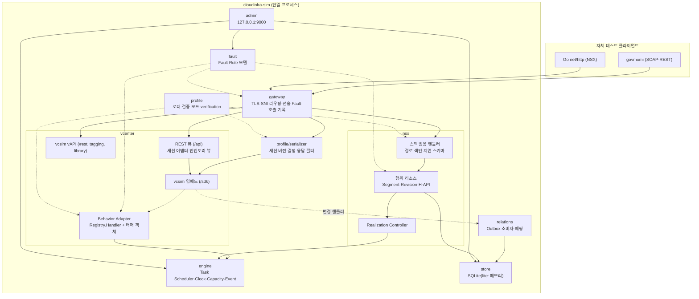
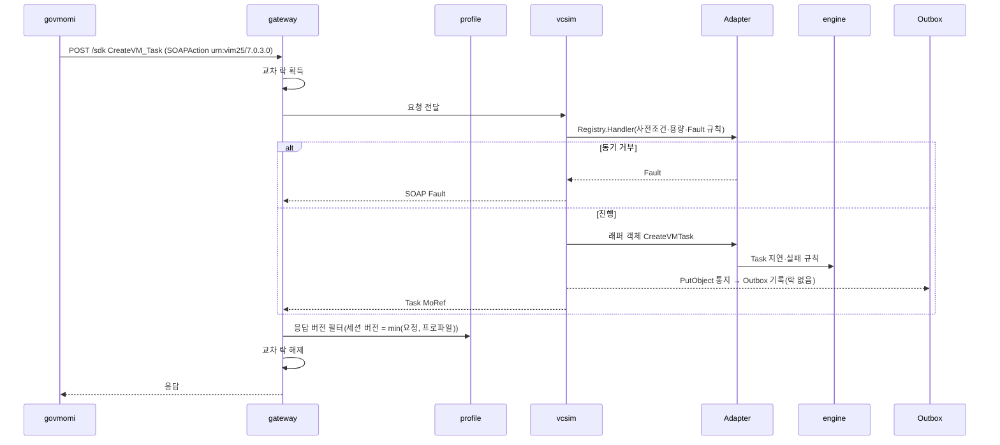
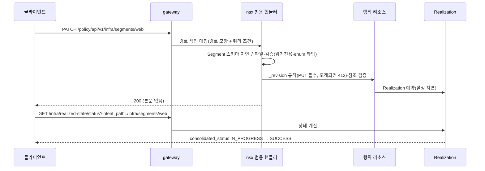
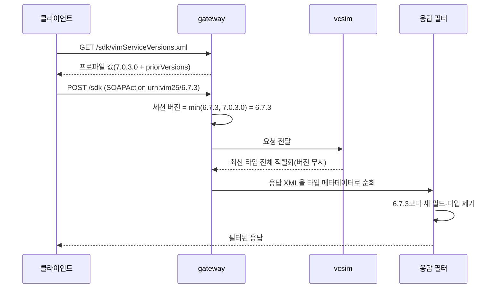
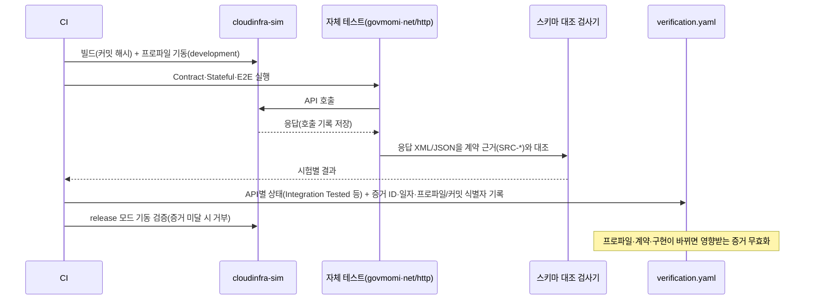
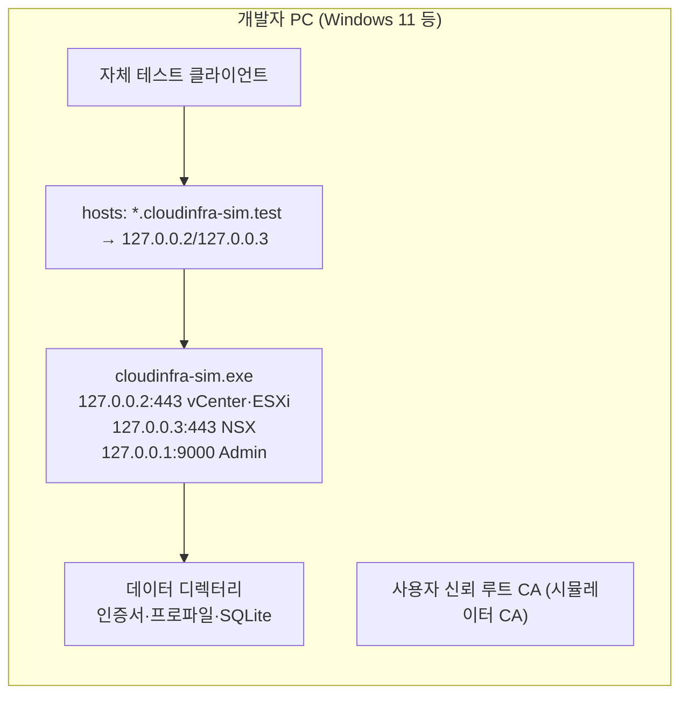

# ARCHITECTURE — 상세 시스템 설계 (권고안 A)

> 관련: PRD 개요 §2, PRD-1 §3~§8, PRD-3 §14, PRD-4 Task 2·WP 0.9·WP 0.11·D3 · 작성일 2026-10-10 (Phase 0b)  
> 근거: Phase 0a/0b PoC(`20-design/development-plan/POC_PLAN.md`). 모듈 경로는 `30-implementation/` 기준.

## 1. 결정 요약

| 항목 | 결정 | 근거 |
|---|---|---|
| 프로세스 구성 | 권고안 A 유지: 단일 Go 실행파일 `cloudinfra-sim` | PoC-17(NSX +10 MB, 28 ms)이 PRD-B §B2 재검토 조건에 해당하지 않음, PoC-21 |
| vCenter 엔진 | govmomi v0.56.0 vcsim 임베드, 포크 없음 | PoC-12, PoC-14 |
| vCenter 행위 로직 | 동기 Fault는 `Registry.Handler`, Task error·상태 변경은 래퍼 객체(`Map().Put`) | PoC-14 |
| 버전 인식 직렬화 | Gateway 계층의 응답 XML 필터 + pyVmomi 추출 메타데이터 | PoC-13 |
| vCenter REST(`/api`) | 자체 구현: vcsim 인벤토리 뷰 + `/api/session` 어댑터 | WP 0.3 조사, PoC-02·03 |
| NSX 엔진 | 스펙 기반 범용 핸들러(지연 컴파일) + 행위 리소스 전용 로직 | PoC-17, PoC-08·09·10·16 |
| 교차 시스템 일관성 | 교차 락은 진입점에서만, vcsim 변경 핸들러는 Outbox만 | PoC-21 |
| 시간 | MVP는 실시간. Virtual Clock은 자체 엔진에만, vcsim 시각은 Phase 4a에 결정 | OPENSOURCE_ASSESSMENT §3.4 |

## 2. 컴포넌트 구성 (다이어그램 1)

## 3. 모듈 책임과 경계

| 모듈 (`internal/`) | 책임 | 소유 상태 | 호출 방향 | 관련 요구사항 |
|---|---|---|---|---|
| `gateway` | TLS 종단(인증서 지문 고정, 리스너별 최대 버전 = 프로파일 `tls.max_version`, 유휴 연결 2분), SNI·Host 라우팅, 미등록 호스트 421, 전송 계층 Fault, 자체 호출 기록·마스킹, 교차 락 획득(변경 요청). **Phase 5:** full 프로필 Trace 본문(64 KB 자름·자격 증명 마스킹)과 SQLite 저장·건수/용량/기간 회전(tracedb.go) | 호출 기록(lite 링버퍼, full SQLite `api_trace`) | → profile, vcenter, nsx | NFR-ARC-0301·0304·0307, NFR-0313~0315, FR-FLT-0204 |
| `profile` | 프로파일 로드, 기동 검증 모드(release/development), 세션 버전 결정, SOAP 응답 필터, `verification.yaml` | 활성 프로파일(읽기 전용) | ← gateway, vcenter, nsx | FR-API-0301~0312, FR-VC-0604~0608 |
| `vcenter` | vcsim 임베드, Behavior Adapter(세션 객체 파괴 시 vcsim 전역 락 회수, viewlocks.go), Fixture 캐시(fixturecache.go)·병렬 파일 입출력(parallel.go, R-45 ②)·결정론적 VM 호스트 배치(placement.go), REST 뷰·세션 어댑터, 버전 협상 경로. **Phase 4b:** VM 생명주기 사전조건·vcsim 보완(lifecycle.go), PBM 정책 연결(pbm.go, vcsim PBM 레지스트리의 ProfileManager 래퍼), Lookup Service의 Gateway 주소·인증서 광고, Content Library /api 어댑터(content.go), PropertyCollector 데이터 버전·이벤트 시간 필터 변환(updates.go) | vcsim 인벤토리(원본) | → engine, relations(Outbox) | FR-VC-*, FR-BE-0401~0408 |
| `nsx` | 스펙 범용 핸들러, 행위 리소스, Revision, H-API, Realization. **Phase 4b:** 요청 단위 쓰기 묶음(batch.go: 한 트랜잭션·최종 상태 참조 검사), 보안·라우팅 행위(policy.go: 내장 rules·service_entries, revise, H-API children), Group 멤버 계산(group.go), 검색(search.go), 시드(seed.go), Manager Logical Switch·Port 파생, 다형 요청 검증 | NSX 리소스 저장소(원본) | → engine, store | FR-NSX-* |
| `relations` | vCenter ↔ NSX 매핑(NSX DVPG), Fabric 인벤토리 파생, 멱등 전체 조정(Reconciliation). **Phase 3 구현:** 별도 관계 저장소 없이 양쪽 원본(vcsim·NSX 저장소)에서 매번 계산 — 파생 객체는 NSX 엔진 캐시에만 둔다. **Phase 4b:** Host Transport Node·상태(NSX 준비 VDS 호스트) 파생 추가. **Phase 5(R-45):** 증분 조정 — vcsim 변경 핸들러가 바뀐 VM·포트그룹 MoRef를 표시하고(별도 뮤텍스만, R-15), VM별 파생 결과와 포트그룹 조회를 캐시해 표시된 객체·새 객체·매핑이 바뀐 포트그룹의 VM만 다시 조회한다. 기동·초기화·복원·관리자 조정·호스트 UUID 변경은 전체 계산. 검증 모드(SIM_RELATIONS_VERIFY)는 매번 전체 계산과 대조 | 없음(계산) | ← nsx(쓰기 후 동기), ← vcenter(변경 신호, 비동기), → vcenter(같은 프로세스 RoundTrip), → nsx | FR-NSX-0601~0609, FR-DM-0401~0404 |
| `engine` | Task 스케줄러(이벤트 기준 타이머), Clock, Capacity, Event | 작업·전이 기록 | ← vcenter, nsx | FR-BE-0501~0612, FR-BE-0701~0704 |
| `fault` | 공통 Fault Rule 모델(조건+동작+횟수+Seed). 전송(gateway)·vCenter 의미(Adapter)·NSX 의미(nsx)·세션(gateway) 계층(Phase 3·4a). vcsim FaultInjector는 쓰지 않음 | Fault 규칙(메모리) | ← admin, ← gateway, ← vcenter, ← nsx | FR-FLT-0201~0207 |
| `clock` | Virtual Clock(정상·테스트 모드, 가속·정지·진행, 실제→가상 구간 대응과 역대응(시간 범위 필터, Phase 4b), 이벤트 기반 대기) | 시계 구간 | ← vcenter, nsx, gateway, admin | FR-BE-0602~0612 |
| `rbac` | 역할 모델(vCenter·NSX), 권한 판정 | 없음(사용자 역할은 users.json) | ← vcenter, nsx | FR-API-0211~0213 |
| `store` | SQLite(lite 인메모리), 트랜잭션. **Phase 5:** 같은 시점 백업(`VACUUM INTO`)·복원(한 트랜잭션), 끝나지 않은 작업 interrupted 처리, full 기간·용량 보존 한도(가상 시각) | 영속 상태 | ← nsx, relations, engine | FR-DM-0301~0307, NFR-0503·0506 |
| `admin` | Seed·Reset, Fault·Clock 제어, 활성 프로파일 조회. **Phase 5:** Snapshot·복원·불일치 검사, Scenario Runner(시작·중지·로그·리포트), 이벤트 조회, Coverage Report | — | → sim(Backend) | TR-SCN-*, FR-API-0304 |
| `scenario` (Phase 5) | 선언형 시나리오 실행 엔진(①~⑨ 단계, 장애 단계, 취소 = 중지, 실행 로그). Admin API Runner와 40-test 회귀 시험이 같은 엔진을 쓴다 | 없음 | → Gateway(외부 인터페이스), → admin | TR-SCN-0106·0107·0301~0303, NFR-0404 |
| `sim` | 조립·수명 주기(실행파일 `main`은 `internal/tempdir`로 임시 파일을 `<data-dir>/tmp/<pid>`에 격리, 강제 종료 잔여물은 다음 기동에 정리). **Phase 5:** Snapshot 조정(snapshot.go: 단일 락 vcsim 덤프 + SQLite 백업 + NSX 상태, manifest·SHA-256, 프로파일·Fixture 대조, 실패 시 초기화), 시나리오 실행 관리(scenarios.go), Coverage Report(coverage.go), 재기동 복원(`--restore-snapshot`, full 종료 시 `_shutdown`) | Snapshot 파일(데이터 디렉터리) | → 모든 모듈 | FR-DM-0209·0304·0306, NFR-0205~0208 |

## 4. 상태 소유권과 락 경계 (FR-BE-0301~0304, R-15)

| 데이터 | 원본 | 사본·캐시 | 변경 경로 |
|---|---|---|---|
| vCenter 관리 객체 | vcsim Registry | REST 뷰는 원본을 직접 읽음(복사 없음) | SOAP 요청, Adapter |
| NSX Policy/Manager 리소스 | `nsx` 저장소 | — | NSX 요청, H-API |
| vCenter–NSX 관계 | `relations` 저장소 | — | Outbox 소비자 |
| 작업·이벤트·호출 기록 | `engine`·`gateway` | — | 내부 |

**락 규칙 (PoC-21에서 확인):**
1. 교차 락은 Gateway·Adapter **진입점에서만** 획득한다. 순서는 항상 교차 락 → vcsim 객체 락이다.
2. vcsim 변경 핸들러(`PutObject`·`UpdateObject`·`RemoveObject`)는 요청 고루틴 안에서 동기로 호출된다. 여기서는 **Outbox에 기록만 하고 어떤 락도 획득하지 않는다.** 이 규칙을 어기면 교착이 생긴다(PoC-21: 400건 중 388건).
3. Outbox 소비자는 요청 경로 밖에서 교차 락을 잡고 `relations`·`nsx`에 반영한다(FR-BE-0403).
4. 조회 요청은 교차 락을 잡지 않는다. 동기화 완료 전 상태의 노출 규칙은 FR-DM-0404에서 정의한다(Phase 3).

## 5. 요청 흐름

### 5.1 VM Create (다이어그램 7)

### 5.2 NSX Segment 생성과 Realization (다이어그램 8)

### 5.3 버전 협상과 버전 인식 직렬화 (다이어그램 11)

### 5.4 자체 테스트 실행과 검증 증거 생성 (다이어그램 12, WP 1.13)

## 6. 다이어그램 목록 (Task 2)

| # | 다이어그램 | 위치 |
|---|---|---|
| 1 | 전체 Component Architecture | §2 |
| 2 | vCenter 내부 Component | §2의 `vcenter` 하위 그래프, §3 |
| 3 | NSX 내부 Component | §2의 `nsx` 하위 그래프, §3 |
| 4 | Behavioral Engine | `BEHAVIOR_SPEC.md` §1 |
| 5 | Data Model / ERD | `DATA_MODEL.md` §2 |
| 6 | vCenter–NSX 관계 | `DATA_MODEL.md` §3 |
| 7 | VM Create Sequence | §5.1 |
| 8 | Segment Create·Realization Sequence | §5.2 |
| 9 | Fault Injection Sequence | `BEHAVIOR_SPEC.md` §5 |
| 10 | Deployment | §7 |
| 11 | 버전 협상·직렬화 Sequence | §5.3 |
| 12 | 자체 테스트·증거 생성 Sequence | §5.4 |

## 7. 배포 (다이어그램 10, D6 결정 전 기본 토폴로지 ①)

- Windows 11에서는 루프백 별칭을 따로 설정할 필요가 없고, 443 바인딩에 관리자 권한도 필요 없다(PoC-19). 관리자 권한은 hosts 등록과 머신 단위 CA 등록에만 필요하다.
- 인증서와 지문은 데이터 디렉터리에 보관해 Reset·재기동 후에도 유지한다(NFR-0315).

## 8. 권고안 A 유지 판단 (PRD-B §B2)

| 재검토 조건 | 판정 |
|---|---|
| Go NSX 범용 핸들러가 기동 시간·메모리 예산을 충족하지 못함 | 해당 없음. NSX를 포함한 전체 프로세스가 유휴 71 MB(예산 300 MB), 기동 약 1.2초(예산 5초) |
| NSX 행위 로직의 Go 구현 비용이 현저히 큼 | 해당 없음. PoC에서 스펙 색인·스키마 검증(약 320줄)과 Segment CRUD·Revision·Realization·H-API(약 250줄)를 Go로 구현 |

## 9. Phase 5 배포·빌드 구조 (NFR-ARC-0203, WP 5.7)

| 항목 | 결정 |
|---|---|
| 실행 형태 | 단일 Go 실행파일(cgo 없음, 순수 Go SQLite) 유지. Windows·Linux·macOS(amd64·arm64) 교차 빌드(`make cross`, CI unit 작업) |
| 배포 패키지 | `50-deployment/dist.sh`(`make dist`): release 빌드(구현 식별자 = 소스 다이제스트) + `data/compatibility-profiles`·`fixtures`·`scenarios` + OS별 설치 스크립트 + SHA256SUMS. NSX 스펙·vAPI 계약은 넣지 않는다(D11) |
| 설치 | Windows `Install-CloudinfraSim.ps1`, macOS·Linux `install-cloudinfra-sim.sh`(hosts·루프백 별칭·CA 신뢰·443 권한, `--dry-run`·`--uninstall`) |
| CI | `.github/workflows/ci.yml`: 호스트 러너(단위·설치 스크립트·교차 빌드), 자체 호스트 러너(통합·Footprint·추가 버전·증거 — NSX 스펙을 사용자가 러너에 배치), 태그 release(배포 패키지). 저장소·러너 구성은 사용자 조치 |
| 다른 언어 | Python은 계약 추출 도구(.agentic)와 선택 SDK 시험(pyVmomi)에만 쓰며 실행 경로에 없다(NFR-0113 유지) |
