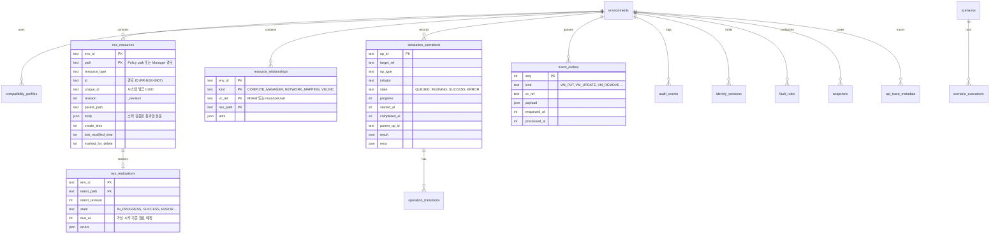
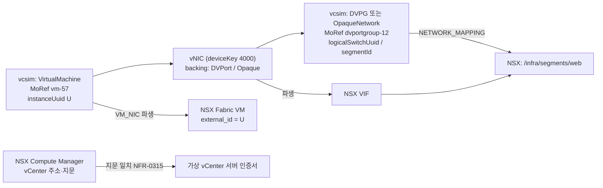

# DATA_MODEL — 상태 모델과 저장소 설계

> 관련: PRD-1 §6(FR-DM-0101 ~ FR-DM-0404), §5.3(FR-BE-0301 ~ FR-BE-0304), PRD-3 §13.2·§13.5, PRD-4 WP 0.9 · 작성일 2026-10-10 (Phase 0b)

## 1. 저장 원칙

| 원칙 | 적용 |
|---|---|
| 원본 하나 (FR-BE-0302) | vCenter 객체는 vcsim Registry가 원본이다. SQLite에 복제하지 않는다(FR-DM-0303). REST 뷰는 Registry를 직접 읽는다 |
| lite 인메모리 (FR-DM-0307) | `lite`는 SQLite `file::memory:?cache=shared`를 쓰고, 명시적으로 Snapshot을 요청할 때만 파일로 기록한다 |
| 트랜잭션 경계 (FR-DM-0305) | NSX 변경 1건(H-API는 요청 1건) = SQLite 트랜잭션 1개. 교차 변경은 교차 락 안에서 Outbox 소비 1건 = 트랜잭션 1개 |
| 보존 한도 (NFR-0501) | 누적 테이블은 `RESOURCE_BUDGET.md` §4 한도로 회전한다 |

## 2. ERD (다이어그램 5)

`compatibility_profiles`, `audit_events`, `identity_sessions`, `fault_rules`, `scenarios`, `scenario_executions`, `snapshots`, `api_trace_metadata`는 PRD-1 FR-DM-0302의 목록을 따른다. 열 상세는 구현 단계에서 정한다. Snapshot·Scenario 실행은 Phase 5 범위다.

## 3. vCenter–NSX 관계 (다이어그램 6)

- 네트워크 표현(DVPG `backingType=nsx` 또는 OpaqueNetwork)은 D8로 정한다. 7.0.3 프로파일의 기본값으로는 VDS 7.0 기반 DVPG를 제안한다.
- Fabric VM·VIF 파생(FR-NSX-0608)은 Outbox 소비자가 만든다. vcsim 변경 핸들러에서 직접 만들지 않는다(락 규칙).

## 4. ID 규칙 (FR-DM-0201 ~ FR-DM-0210)

| ID 종류 | 형식·생성 | 근거 |
|---|---|---|
| vCenter MoRef | vcsim 발급(`vm-57`, `host-21`, `domain-c8`, `datastore-11`, `dvportgroup-12`) | vcsim, FR-DM-0204 |
| REST 리소스 ID | MoRef 값과 같은 문자열 | PoC-03, FR-DM-0204 |
| VM instanceUuid / BIOS UUID | vcsim 발급. Fixture는 Seed 기반으로 결정론적으로 생성 | FR-DM-0210 |
| Task MoRef | vcsim 발급(`task-116`) | PoC-04 |
| NSX 경로 ID | 클라이언트 지정(`/infra/segments/{id}`) | FR-NSX-0403 |
| NSX `unique_id` | 시뮬레이터가 UUID 발급(Seed 기반), 경로 ID와 분리 | FR-NSX-0407 |
| 내부 op_id | ULID(단조 증가) | FR-DM-0201 |

**확인 필요 (Phase 1):** vcsim MoRef 카운터가 Seed·Reset 후에도 같은 순서로 같은 값을 만드는지 확인한다(FR-DM-0210 결정론). 삭제 후 ID 재사용 규칙(FR-DM-0208)도 vcsim 동작을 확인한다.

## 5. 무결성 절차 (FR-DM-0305)

1. 교차 변경은 교차 락 안에서 처리한다. vCenter 변경은 vcsim이 적용하고, 관계·NSX 반영은 Outbox 소비자가 트랜잭션 하나로 처리한다.
2. Outbox 처리 실패 시 `processed_at`을 비운 채 재시도한다. 재기동 시 미처리 Outbox를 다시 처리한다(`full` 프로필, FR-BE-0304).
3. `lite` 프로필은 재기동 시 상태를 복원하지 않는다(FR-BE-0208은 MVP 이후).
