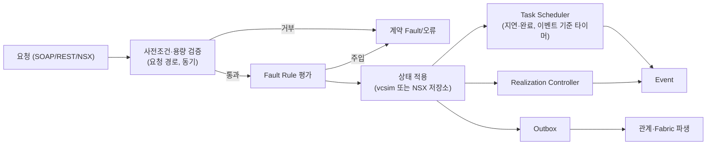
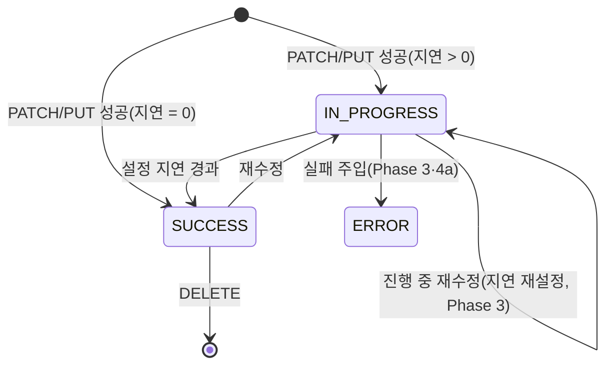
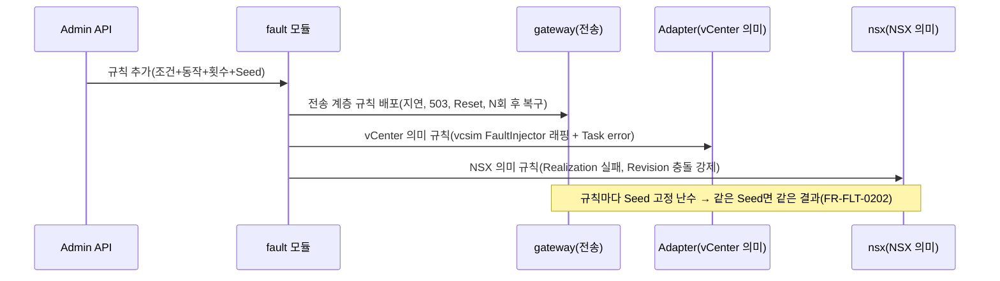

# BEHAVIOR_SPEC — 상태 전이·Task·Realization·오류 명세

> 관련: PRD-1 §3.4·§3.5·§4.4·§4.5·§5·§8, PRD-4 Task 2 · 작성일 2026-10-10 (Phase 0b)  
> 각 규칙의 '근거' 열은 TEST_STRATEGY §5의 근거 ID다. '가정'은 근거를 확보하기 전까지 미검증으로 표시한다.

## 1. 행위 엔진 구성 (다이어그램 4)

## 2. VM 생명주기 (MVP)

| 작업 | 사전조건 (거부 시 Fault) | 결과 상태 | 근거 |
|---|---|---|---|
| CreateVM_Task | 대상 Folder·ResourcePool·Datastore 존재; CPU·메모리가 Host/Cluster 가상 용량 이내(초과 시 `InsufficientResourcesFault`, Task error); 같은 Folder에 같은 이름 없음(`DuplicateName` Task error — vcsim은 미검사, Adapter가 검사, R-24) | poweredOff VM 추가, Task success(result = VM MoRef) | SRC-GOVMOMI, PoC-14·04 |
| ReconfigVM_Task | VM 존재; 전원이 켜진 상태에서 Hot-add가 허용되지 않은 CPU·메모리 변경은 `InvalidPowerState`(규칙은 프로파일 behavior-rules에 정의, FR-VC-0418) | config·summary 변경 | 가정 → SRC-DOC 확인 |
| PowerOnVM_Task | poweredOff 또는 suspended | poweredOn | SRC-GOVMOMI |
| PowerOffVM_Task | poweredOn | poweredOff | SRC-GOVMOMI |
| Destroy_Task | poweredOff(켜져 있으면 `InvalidPowerState`) | 인벤토리에서 제거, 관계 정리(Outbox) | SRC-GOVMOMI, FR-BE-0206 |
| 삭제 후 조회 | — | SOAP: `ManagedObjectNotFound`, REST: 404 `NOT_FOUND` | SRC-GOVMOMI, 가정(REST 오류 본문) |

## 3. Task 계약 (FR-VC-0501 ~ FR-VC-0506, FR-BE-0501 ~ FR-BE-0503)

| 항목 | 규칙 | 비고 |
|---|---|---|
| 상태 전이 | queued → running → success / error | 지연 0이면 즉시 success 가능 |
| 시각 | startTime·completeTime은 실제 시간(MVP). Virtual Clock 적용은 Phase 4a | R-12 |
| 진행률 | 실행 중 0~100. 완료 후 값은 계약 확인 필요(vcsim은 0) | 미검증 |
| 결과·오류 | success → result(MoRef 등), error → `info.error`(LocalizedMethodFault) | PoC-04, PoC-14 |
| recentTask·Task 보존 | 완료 Task 객체는 보존 한도(lite 200, full 10,000, `--retain-tasks`로 조정, 무제한 금지)까지만 남기고, 초과분은 레지스트리·TaskManager·대상 엔터티 `recentTask`에서 함께 제거 | vcsim은 recentTask만 200건으로 자르고 객체는 남김(R-22) |
| info.name | 요청한 SOAP 메서드의 WSDL 이름(예: `CreateVM_Task`, 형식 vmodl.MethodName). vcsim의 내부 이름(`CreateVm`)을 보정 | SRC-VIM-TYPEINFO, R-26 |
| 지연·실패 주입 | Adapter가 요청 경로에서 Task 지연·error 결과를 정한다 | WP 2.7, WP 4.5 |

### 3.1 SOAP 응답 계약 보정 (Phase 2b, 스키마 대조 검사기)

| 항목 | 규칙 | 근거 |
|---|---|---|
| VM 필수 열거 속성 | `runtime`·`summary.runtime`의 `faultToleranceState`=`notConfigured`, `recordReplayState`=`inactive`(FT·Record/Replay 미사용 VM) | SRC-VIM-TYPEINFO(필수), 값은 가정(R-27) |
| 빈 조회 결과 | 일치하는 객체가 없는 `RetrievePropertiesEx`·`ContinueRetrievePropertiesEx`는 `returnval` 없음(null) | API 문서, R-27 |
| 버전 필터(경로 요청) | 속성 경로로 요청한 `propSet`·`changeSet`도 경로의 각 단계 도입 버전이 세션 버전보다 새로우면 뺀다 | SRC-VIM-TYPEINFO, 제외 동작은 가정(R-11) |
| IP 접속 | SNI·Host가 IP 주소면 접속한 리스너의 서비스(vCenter 또는 NSX)로 보낸다. 알 수 없는 이름은 421 | 실제 제품도 IP로 응답 |

## 4. NSX Policy 동작

| 규칙 | 내용 | 근거 |
|---|---|---|
| 생성 | `PATCH`·`PUT` upsert. Segment 성공 응답 200, 본문 없음 | SRC-DOC, SRC-NSX-321 |
| PATCH 의미 | 부분 PATCH 비활성(기본, 스펙 `nsx-partial-patch-config.enable_partial_patch` 기본 false): 본문을 객체 전체로 보고 교체(서버 관리 필드 유지, 스펙 기본값 적용). 활성(시스템 설정 또는 `nsx-enable-partial-patch: true`): 지정 필드만 병합, 중첩 객체 병합, 배열 교체. 요청 헤더가 시스템 설정보다 우선 | SRC-NSX-321(설정 경로·기본값), 비활성 시 교체 의미는 가정 |
| PUT 의미 | 전체 교체. 기존 객체가 있으면 `_revision` 필수, 없거나 오래되면 **412** | SRC-NSX-321 |
| PATCH + `_revision` | 값이 있고 오래되면 412 | 가정 |
| Revision | 생성 0, 변경마다 +1 | SRC-NSX-321, PoC-09 |
| 읽기전용 필드 | 스펙 `readonly` 필드를 요청에 넣으면 400. 예외: H-API의 `marked_for_delete` | SRC-NSX-321, PoC-17·16 |
| enum·타입 | 스펙 위반은 400 | SRC-NSX-321 |
| H-API | `PATCH /infra` children을 검증한 뒤 한꺼번에 적용, 실패 시 전체 미반영 | 원자성은 가정(FR-NSX-0225) |
| 스펙 기본값 | 생성·교체 시 스펙 `default` 값을 채운다(예: Segment `admin_state` UP). `display_name` 미지정 시 ID | SRC-NSX-321, display_name은 가정 |
| 참조 검증 | `connectivity_path`·`transport_zone_path`·`tier0_path`가 가리키는 객체가 없으면 400 | 가정(상태·메시지 형식, FR-NSX-0410) |
| 삭제 의존성 | 다른 객체가 참조 중인 객체 삭제는 400 | 가정(FR-NSX-0415) |
| 스펙 제공 | `GET /api/v1/spec/openapi/{nsx_api.json, nsx_policy_api.json}`은 활성 프로파일 스펙 파일, 그 외 404 | 경로는 스펙 밖, 가정(FR-NSX-0104) |
| 경로 밖 요청 | 활성 프로파일 스펙에 없으면 404(4.x 전용 경로 포함) | FR-API-0401, PoC-17 |

### 4.1 Realization (FR-NSX-0501 ~ FR-NSX-0509)

- 조회: `GET /infra/realized-state/status?intent_path=` → `consolidated_status.consolidated_status`와 스펙 필수 `publish_status`(SUCCESS → `REALIZED`, IN_PROGRESS → `UNREALIZED`; 대응은 가정, R-28).
- 삭제된 intent 조회 응답은 근거 확보 전까지 404(가정).

## 5. Fault Injection (다이어그램 9)

MVP에서는 Fault Injection을 쓰지 않는다(FR-FLT-0207: 정상 요청에 임의 오류 금지). 전송 계층은 Phase 3(구현됨, 아래 표), vCenter·NSX 의미 계층은 Phase 4a에 구현한다.

**전송 계층 Fault Rule (Phase 3, `internal/fault`, Admin `/v1/faults`)**

| 항목 | 규칙 | 근거 |
|---|---|---|
| 규칙 모델 | 조건(product·method·path_prefix·soap_method) + 동작(delay·status·unavailable) + 횟수(0=제거까지, N=N회 적용 후 복구) + Seed(확률 판정) | FR-FLT-0205 |
| 적용 순서 | 일치하는 규칙 중 생성 순 첫 규칙 하나. 확률 미달이면 다음 규칙 | 가정 |
| 오류 형식 | NSX: ApiError, vCenter REST: vAPI 오류(`error_type`은 상태 대응), SOAP(/sdk): 프록시 수준 HTTP 오류(text/plain, SOAP Fault 아님). unavailable은 503 + Retry-After | 오류 계약은 FR-FLT-0205, SOAP 형식은 가정 |
| 기록 | `fault injected` 경고 로그(규칙 ID·동작·적용 횟수), Trace `fault_rule`, 감사 기록(Admin 동작) | NFR-0403 |
| 초기화 | 환경 초기화 때 모든 규칙 제거 | 가정 |

## 6. 오류 계약 (MVP 기본 오류, WP 2.8)

| 상황 | vCenter SOAP | vCenter REST | NSX |
|---|---|---|---|
| 인증 실패 | `InvalidLogin` | 401 | 403(스펙 응답 목록에 401 없음) |
| 미인증 호출 | `NotAuthenticated`(익명 `RetrieveProperties`는 ServiceInstance만 허용, 가정, R-24) | 401 | 403(스펙 응답 목록 기준) |
| 잘못된 입력 | `InvalidArgument` | 400 `INVALID_ARGUMENT` | 400 |
| 없는 리소스 | `ManagedObjectNotFound` | 404 `NOT_FOUND` | 404 |
| 중복 생성 | `DuplicateName` | 400 `ALREADY_EXISTS` | upsert라 오류 아님 |
| Revision 충돌 | — | — | 412 |
| 미지원 | 세션 버전 밖 메서드 `MethodNotFound`, 알 수 없는 메서드 `InvalidRequest`(vcsim 응답, 미지원 집계 대상, R-25) | 404·501(계약 확인) | 404(Manager·Policy 공통, FR-NSX-0231) |

NSX 오류 본문은 스펙 `ApiError`(`module_name`, `error_message`, `error_code`, `details`, `error_data`, `related_errors`)를 따른다. PoC의 `httpStatus` 필드는 스펙에 없으므로 쓰지 않는다. 상황별 `error_code` 값은 스펙에 없어 가정으로 기록한다. REST 오류는 SRC-VAPI-SDK-7032로 확정했다: 본문은 `com.vmware.vapi.std.errors.error` 구조(`error_type`, `messages[]`, 선택 `data`), 상태 코드는 vAPI 런타임 매핑(UNAUTHENTICATED 401, UNAUTHORIZED 403, NOT_FOUND 404, INVALID_ARGUMENT·ALREADY_EXISTS 400, CONCURRENT_CHANGE 409, SERVICE_UNAVAILABLE 503)을 따르고, 오퍼레이션별로 선언된 오류만 쓴다. DELETE 성공은 204다.

## 7. 교차 시스템 관계 (Phase 3, `internal/relations`)

| 항목 | 규칙 | 근거 |
|---|---|---|
| 네트워크 매핑 | NSX 준비 VDS(Fixture `vds_transport_zones`, MoRef 순 첫 VDS)에 연결된 TZ의 Segment만 vCenter NSX DVPG가 된다. TZ 미지정 Segment는 기본 Overlay TZ(Fixture 첫 Overlay). DVPG: `backingType=nsx`, `segmentId`=Policy Path, `logicalSwitchUuid`=Segment `unique_id`, 이름=display_name, 포트그룹 형식 ephemeral | D8, FR-NSX-0603·0606·0607. 준비 VDS 선택·기본 TZ·ephemeral은 가정 |
| 동기화 시점 | NSX 쓰기는 같은 요청 안에서 동기 조정(응답 전에 DVPG 생성). vCenter 변경은 vcsim 변경 신호 → 조정 고루틴(비동기) | FR-BE-0403, R-15 |
| 동기화 전 상태 | 동기화가 끝나기 전 Segment Realization은 IN_PROGRESS, 파생 NSX 객체는 아직 보이지 않음 | FR-DM-0404 |
| 동기화 실패 | 준비 VDS가 없는 등 vCenter 반영 실패 → Realization ERROR, realized-entities에 `publish_status_error`·alarms, NSX 알람 OPEN(회복 시 RESOLVED) | FR-NSX-0504, FR-MET-0201. 실패 원인·알람 feature 값은 가정 |
| 파생 인벤토리 | Host → Discovered Node(`external_id`=호스트 UUID, `cm_local_id`=MoRef), VM → Fabric VM(`external_id`=instanceUuid, `compute_ids`, `host_id`), vNIC → VIF(`external_id`=instanceUuid-deviceKey), NSX DVPG에 연결된 vNIC → Segment Port(`attachment.id`=VIF `lport_attachment_id`) | FR-NSX-0602·0604·0608, FR-NSX-0226·0227. 값 형식은 가정 |
| 시스템 소유 | 파생 객체는 `_system_owned`(Policy), 저장소에 기록하지 않고 조정 때 다시 만든다. 사용자 변경은 403 | FR-BE-0302, 403은 가정 |
| VM Tag | `/fabric/virtual-machines?action=update_tags·add_tags·remove_tags`(204). NSX가 소유·저장하며 vCenter Tag와 무관 | FR-NSX-0226·0609 |
| Group 멤버 | `/infra/domains/{d}/groups/{g}/members/virtual-machines`: Condition(VirtualMachine, Tag·Name, EQUALS·NOTEQUALS·CONTAINS·STARTSWITH·ENDSWITH), ExternalIDExpression, ConjunctionOperator(AND·OR, 왼쪽부터) | FR-NSX-0605. 연산 우선순위는 가정 |
| 삭제 의존 | 하위 객체(Segment Port 등)가 있는 객체 삭제는 400. VM 삭제 → 파생 제거 → Segment 삭제 가능 → DVPG 제거. VM이 남은 DVPG는 지우지 않고 drift로 보고 | FR-NSX-0415, FR-BE-0206, TR-E2E-0804 |
| 복구 | 조정은 멱등 전체 계산. vCenter에서 NSX DVPG를 지우면 다시 만든다. Admin `POST /v1/reconcile`로 즉시 조정 | FR-DM-0402·0403 |
| Realization 의존 | `connectivity_path`·`tier0_path` 대상이 SUCCESS가 아니면 IN_PROGRESS. 진행 중 재수정은 최신 intent 기준(`intent_version`=_revision) | FR-NSX-0505·0507, 가정 |
| Namespace | NSX 결정론적 ID와 Fixture VM UUID는 Namespace·Seed·키로 만든다. 같은 Seed라도 Namespace가 다르면 겹치지 않는다 | FR-DM-0207·0210 |

## 8. 메트릭·이벤트·감사 (Phase 3)

| 항목 | 규칙 | 근거 |
|---|---|---|
| 메트릭 계산 | QueryPerf는 조회 시 계산(시계열 미저장). u(t) = 기준(0.15~0.55, 엔터티별) + 0.1·sin(2π·t/1h + 위상). VM CPU MHz = u·vCPU·코어 MHz, 메모리 = u·할당. 꺼진 VM은 표본 없음(-1). Host = 켜진 VM 합 + 오버헤드 1%(용량 상한), Cluster = Host 합. 표본 시각은 간격 배수 | FR-MET-0101·0102·0104, FR-BE-0704. 수식·오버헤드·-1은 가정(R-30) |
| 덮어쓰기 | Admin `PUT /v1/metrics/overrides`(값 또는 missing=-1), 초기화 때 제거 | FR-MET-0103 |
| 호스트 용량 | 호스트 하드웨어 코어·메모리 = Fixture 가상 용량 | FR-BE-0701·0704, R-31 |
| 이벤트 | vcsim: VM Created·Removed·PoweredOn·PoweredOff. 추가: Task 실패 → TaskEvent(info.state=error), 호스트 연결 끊기·다시 연결 → HostDisconnectedEvent·HostConnectedEvent. userName = 요청 사용자(Task info.reason) | FR-MET-0201~0203, R-32 |
| 감사 | 상태 변경 요청(NSX·REST 비 GET, SOAP *_Task)과 인증 동작(실패 포함), Admin 변경: cid·사용자·동작·대상(MoRef, Task ID)·상태. 관계 조정 변경은 cause에 원인 요청 cid. 자격 증명 미기록, 초기화에도 유지, lite 1,000건 | NFR-0306·0503, FR-BE-0209 |

## 9. Fault 계층 확장·Virtual Clock·세션 만료 (Phase 4a)

**Fault Rule 계층(`/v1/faults`, 공통 모델 FR-FLT-0205)**

| 계층 | 동작 | 적용 위치·응답 | 근거 |
|---|---|---|---|
| transport | delay·status·unavailable(503)·timeout(응답 없이 붙잡았다 끊음)·reset(바로 끊음) | Gateway. 오류 형식은 §5 | FR-FLT-0117~0120·0123~0125 |
| vcenter | task_fail(fault 이름, delay_ms 동안 running 뒤 실패), soap_fault, task_delay(가상 시간 지연 뒤 원래 동작 실행, 안쪽 Task 숨김), host_disconnect·host_maintenance·datastore_full(규칙이 있는 동안 상태 유지, 제거 시 복구) | Behavior Adapter(요청 경로 안). Task 실패는 정상 Task 응답 + Task error | FR-FLT-0110~0116·0121·0122, FR-BE-0605 |
| nsx | realization_fail(ERROR·오류 정보·알람), realization_hang(IN_PROGRESS 유지, Timeout 재현), revision_conflict(412) | NSX 엔진 쓰기. 다시 쓰면 재실현 | FR-FLT-0116, FR-NSX-0504·0506 |
| session | expire(일치한 요청의 세션을 만료시킨 뒤 전달 → 인증 실패) | Gateway → 엔진 세션 저장소 | FR-FLT-0102·0203 |

조건(FR-FLT-0202): product·method·path_prefix·soap_method·resource(MoRef 또는 NSX intent 경로)·user·nth(N번째 일치 호출부터)·after(이 호출이 관측된 뒤부터)·not_before/not_after(가상 시각)·probability+seed. 인프라 상태 동작은 요청마다 적용하지 않는다. "특정 Task 상태" 조건은 task_fail의 delay_ms(running 중 실패)로 표현한다(가정).

**Virtual Clock(`/v1/clock`, FR-BE-0602~0604·0609)**: 정상 모드는 가상 = 실제, 테스트 모드에서 rate(가속, 0<rate≤1000)·frozen(정지)·advance_ms·advance_to(진행, 되돌리기 불가). 가상 시간을 쓰는 곳: Realization 지연, 세션 유휴 만료, Task 지연·실패 지연, 메트릭 계산, NSX 메타데이터 시각, SOAP 응답의 dateTime(vcsim 실제 시각 변환). HTTP 타임아웃·네트워크 대기는 실제 시간(FR-BE-0610). 환경 초기화는 정상 모드로 돌린다(가정).

**세션 유휴 만료(FR-API-0204·0209, FR-BE-0607)**: SOAP·REST 1,800초(가정, behavior-rules `session`), NSX 1,800초(SRC-NSX-321 HttpServiceProperties 기본값). 마지막 사용(가상 시각) 기준. 만료 시 SOAP `NotAuthenticated`, REST 401 `UNAUTHENTICATED`, NSX 403. 내부 세션(같은 프로세스 클라이언트)은 만료하지 않는다.

**기본 알람 'Datastore usage on disk'(FR-MET-0201)**: 메트릭 식(사용률 75% 경고·85% 위험, 가정). 데이터스토어 여유 공간이 바뀌면 평가해 triggeredAlarmState·overallStatus와 AlarmStatusChangedEvent 반영.

## 10. 권한(RBAC, Phase 4a)

| 항목 | 규칙 | 근거 |
|---|---|---|
| 권한 ID | SOAP 메서드별 권한은 공식 타입 정보(pyVmomi 메서드 privilege)에서 관리 객체 타입 상속을 따라 찾는다. 비어 있는 메서드는 보정표(Destroy_Task·Rename_Task·ReconfigVM_Task) | SRC-VIM-TYPEINFO, 보정표는 가정(R-35) |
| vCenter 역할 | Admin(전체), ReadOnly(System.Anonymous·View·Read), VirtualMachineOperator(System.*·VirtualMachine.Interact.*·VirtualMachine.Config.*) | 이름은 vSphere 기본 역할, VirtualMachineOperator는 시험용 가정 |
| 범위 | 사용자 scope(MoRef)가 있으면 그 엔터티와 하위에서만(System.* 제외) | FR-API-0211 |
| 권한 없음 | SOAP `NoPermission`(object·privilegeId), NSX 403 ApiError. 권한 정보가 없는 세션 객체(PropertyFilter·View 등) 메서드는 허용 | FR-API-0212, NSX 메시지는 가정 |
| NSX 역할 | enterprise_admin(전체), auditor(GET·HEAD만) | NSX 기본 역할 이름 |
| 시험 사용자 | Admin `/v1/users`로 역할·범위를 지정해 만든다(비밀번호는 생성 응답에서만). 기본 사용자는 지울 수 없다 | FR-API-0213 |

## 11. NSX 보안·라우팅·H-API·검색 (Phase 4b, WP 4.9)

| 항목 | 동작 | 근거 |
|---|---|---|
| 요청 쓰기 단위 | 한 요청의 모든 변경(내장 하위 객체·H-API children 포함)을 모아 참조·삭제 검사를 최종 상태로 한 뒤 한 트랜잭션으로 기록. 실패하면 아무것도 반영하지 않음 | NFR-0204, H-API 원자성은 **가정**(FR-NSX-0225) |
| 성공 응답 | PATCH 200 본문 없음, PUT·`?action=revise` 200 + 객체, Manager 컬렉션 POST 201 + 객체(서버 ID). 스펙 2xx 응답 정의를 따름 | SRC-NSX-321 오퍼레이션 응답 |
| 요청 검증 | 타입·enum·필수(최상위, 다형 하위 타입 원소)·읽기전용·maxItems. `resource_type`이 정의 이름이면 그 하위 타입 스키마로 검사(예: Condition의 key·value·member_type, L4PortSetServiceEntry의 l4_protocol). 생략한 `resource_type`은 정의 이름으로 채움 | SRC-NSX-321 discriminator |
| 미구현 action | 스펙에 있으나 행위가 없는 `POST …?action=` 는 저장하지 않고 501, 미지원 API로 집계 | FR-API-0401, 상태 501은 **가정** |
| 참조 검사 | `connectivity_path`·`transport_zone_path`·`tier0_path`·`tier1_path`·`segment_path`·`edge_cluster_path`·`scheduler_path`, 배열 `source_groups`·`destination_groups`·`services`·`scope`, Group `PathExpression.paths`. 값이 `/infra/…`인 것만(ANY·IP 제외). 없으면 400, 참조 중이면 삭제 400 | FR-NSX-0410·0415, 상태·메시지 **가정** |
| 하위 객체 삭제 | 하위 객체가 있으면 삭제 거부(400). 예외: Security/Gateway Policy의 Rule, Service의 Service Entry(함께 삭제), H-API `marked_for_delete`(하위 트리 포함) | 스펙 DeleteSecurityPolicyForDomain·ChildPolicyConfigResource 설명 |
| Security Policy 내장 rules | PATCH: 나열한 Rule만 만들거나 바꿈(나머지 유지). PUT: 전체 교체(나열하지 않은 Rule 삭제). 단일 GET 응답에 `rules`(sequence_number 순)와 `rule_count`. 목록 조회에는 `rules`를 넣지 않음 | 스펙 설명("pass all the rules which you wish to edit", "All the rules are replaced"), 목록 제외는 **가정** |
| Rule | `rule_id`는 시스템 할당(1001부터 증가, 기본 Rule 2 — **가정**), 갱신해도 유지. `sequence_number` 생략 시 0(스펙). `source_groups`·`destination_groups`·`services`의 "ANY"(대소문자 무관)는 단독이어야 함(400) | 스펙 Rule·BaseRule 설명 |
| revise | `operation` insert_top(기본)·insert_bottom·insert_after·insert_before(`anchor_path`). 형제(Rule: 같은 Policy, Policy: 같은 Domain·category) 사이 빈 번호를 쓰고 없으면 10 간격으로 다시 매김(형제 `_revision` 증가) | 스펙 매개변수, 번호 체계 **가정** |
| Service | `service_entries` 내장(Security Policy와 같은 방식, **가정**). `is_default=true` Service는 수정·삭제 403(스펙 "can't be modified/deleted", 상태 **가정**) | SRC-NSX-321 Service |
| Group expression | 홀수 길이·짝수 위치 조건·홀수 위치 ConjunctionOperator, Condition+NestedExpression ≤ 5, 경로·IP 등 ≤ 500, NestedExpression은 Condition·AND·같은 member_type, Segment·SegmentPort 외에는 operator 필요 → 위반 400 | 스펙 Group.expression·NestedExpression·Condition 설명 |
| Group 멤버 | VM(Fabric VM, NSX VM Tag), Segment, Segment Port, IP. Condition은 대소문자 무관(스펙), `scope\|tag`, scope_operator. ExternalIDExpression, PathExpression(중첩 Group 포함), NestedExpression(AND). NOTIN·게스트 key·MAC·Identity는 미평가 | 스펙, 미평가 항목은 미구현 |
| Realization 의존 | `connectivity_path`·`tier0_path`·`tier1_path`·`segment_path` 대상이 SUCCESS여야 SUCCESS | FR-NSX-0507, **가정** |
| 시드 | Domain default, 기본 섹션 default-layer3-section + default-layer3-rule(ALLOW, ANY), 기본 Service HTTP·HTTPS·SSH·DNS·DNS-UDP·ICMP-ALL, Fixture Tier-0·Edge Cluster·Group grp-NN(app\|grp-NN)·Security Policy sp-NN | 객체 이름은 NSX 기본 객체 이름, 구성 세부 **가정** |
| H-API | `PATCH /infra`만 children 처리(PUT은 Infra만, 스펙). Child<Type> 래퍼의 하위 경로는 스펙에서 '부모 경로 + /<컬렉션>/{id}'이고 본문이 그 타입인 템플릿으로 정함. ChildResourceReference 대상이 없으면 400. `enforce_revision_check=true`일 때만 `_revision` 검사 | 스펙 PatchInfra 설명·매개변수 |
| 검색 | Lucene 부분집합(API_COVERAGE_MATRIX §6.2) | FR-NSX-0232, **가정** |
| Manager 파생 | Host Transport Node: NSX 준비 VDS의 호스트(VDS 호스트 스위치, TZ 끝점 = vds_transport_zones), 상태는 vCenter 연결 끊김 → failed·MPA_DISCONNECTED, 유지보수 → maintenance_mode ENABLED. Logical Switch·Port: Policy Segment·Port 실현(ID = unique_id, `_protection` REQUIRE_OVERRIDE, 생성자 nsx_policy, 사용자 쓰기 403) | FR-NSX-0206·0207, 값 형식 **가정** |

## 12. vCenter 생명주기·보조 서비스 (Phase 4b, WP 4.11)

| 항목 | 동작 | 근거 |
|---|---|---|
| 템플릿 | 전원 켜기·재설정·일시 중단·스냅샷·재구성·사용자 지정·복귀는 NotSupported(Task error). 템플릿 변환·되돌리기 뒤 config.template·summary.config.template·resourcePool 변경을 알림. MarkAsVirtualMachine의 pool이 ResourcePool이 아니면 InvalidArgument | Fault 선택은 **가정**(R-40) |
| ResetVM_Task·SuspendVM_Task | 전원이 켜진 VM만(InvalidPowerState requested=poweredOn) | 선언 Fault(InvalidState 계열) |
| CloneVM_Task | 결과 VM의 vCPU·메모리 용량, 대상 데이터스토어 여유 공간 검사(CreateVM과 같은 규칙), 이름 중복 DuplicateName | FR-VC-0417, 선언 Fault |
| Rename_Task | 같은 폴더 이름 중복 DuplicateName, 빈 이름·80자 초과 InvalidName(80자는 **가정**) | 선언 Fault |
| RegisterVM_Task | 다른 이름으로 등록 가능(R-36 보완), 이미 등록된 vmx는 AlreadyExists | 선언 Fault |
| 스냅샷 복귀 | 스냅샷 시점의 하드웨어 구성(config.hardware, summary.config)과 전원 상태(트리 state: 메모리 없는 스냅샷은 poweredOff)로 되돌림. suppressPowerOn이면 켜지 않음 | API 설명(RevertToSnapshot_Task) |
| Guest Customization | vcsim 논리 상태 전이: CustomizeVM_Task(꺼진 VM) → pendingCustomization → 전원 켜기 시 hostName·IP 적용, CustomizationStartedEvent·Succeeded | FR-VC-0416 |
| Lookup Service | 등록 정보의 끝점 URL은 Gateway 주소(https://vcenter.<도메인>), SslTrust는 Gateway 서버 인증서. STS 등록은 나열되지만 STS 끝점은 미지원(FR-VC-0209 미채택) | FR-VC-0208 |
| PBM | vcsim 정책 목록(6.7 기본 정책 기반, 7.0과 차이 미검증). VM 생성·복제·재구성·이전에 지정한 VM 홈 정책(VirtualMachineDefinedProfileSpec)을 Task 성공 시 연결, EmptyProfileSpec은 해제. 디스크 단위 정책: 생성·재구성 deviceChange[].profile, 복제·이전 disk[].profile을 디스크(virtualDiskId `VM:디스크 키`)와 연결(추가 디스크는 Task 성공 뒤 새 디스크에 추가 순서대로 대응). 디스크 제거·VM 삭제 뒤 연결은 지운다 | FR-VC-0210, R-37 |
| 클러스터 vSAN 설정 | vSAN을 켜지 않은 클러스터도 configurationEx.vsanConfigInfo를 enabled=false·defaultConfig.autoClaimStorage=false로 채운다(vcsim은 비워 둠, Fixture·CreateClusterEx 모두). community.vmware vmware_cluster_info가 바로 읽는다 | **가정**(실제 vCenter 동작), TR-COV-0306 |
| ClusterComputeResource.GetResourceUsage | vcsim 미구현 → Adapter가 응답: CPU·메모리 용량은 클러스터 요약(호스트 합), 사용량은 호스트 quickStats 합, 스토리지는 클러스터 데이터스토어 용량·사용량(중복 제외). 클러스터가 아닌 대상은 MethodNotFound 그대로 | **가정**(계산 방식), TR-COV-0306 |
| Content Library /api | vcsim 구형 /rest 구현을 /api 형식으로 변환: 본문 = request_body_parameter 구조, `?action=find`, 비구조 출력은 감싸지 않음, DELETE 204, create 201(**가정**), 계약 필드만 출력, *_time은 가상 시각 UTC | SRC-VAPI-SDK-7032, R-38 |

## 13. PropertyCollector 데이터 버전·이벤트 시간 필터 (Phase 4b, WP 4.6)

| 항목 | 동작 | 근거 |
|---|---|---|
| 데이터 버전 | WaitForUpdatesEx·WaitForUpdates·CheckForUpdates 응답 UpdateSet.version을 세션·Collector별 증가 값("1", "2", …)으로 발급. 요청 version은 빈 문자열이거나 발급한 값이어야 하며 아니면 InvalidCollectorVersion | API 문서 version 매개변수 설명, 선언 Fault |
| 부분 응답 | maxObjectUpdates를 넘으면 truncated=true와 버전을 주고, 그 버전으로 나머지를 받음 | vcsim pageUpdateSet + 버전 발급 |
| 제한 | 지난(가장 최근이 아닌) 버전을 다시 보내면 그 버전 이후 변경이 아니라 마지막 호출 이후 변경을 돌려줌 | R-39 |
| 시간 필터 | EventFilterSpec·TaskFilterSpec의 time.beginTime·endTime은 가상 시각으로 해석(시작은 가상 시각이 그 값 이상인 가장 이른 실제 시각, 끝은 그 값 이하인 가장 늦은 실제 시각으로 바꿔 vcsim에 전달; 정지 구간은 구간 전체 포함) | FR-BE-0611 |

## 14. Snapshot/Restore·재기동 복원·Scenario Runner·보존 (Phase 5)

Snapshot은 실제 vCenter·NSX 기능이 아니라 시뮬레이터 관리 기능이다(Admin API). 아래 동작 중 **가정**은 근거가 없는 설계 선택이다.

| 항목 | 동작 | 근거 |
|---|---|---|
| Snapshot 생성 | `POST /v1/snapshots {"name"}` → 201 manifest. 교차 락 하나를 쥔 채 vcsim 인벤토리 덤프(govc object.save 형식 ObjectContent XML + 데이터스토어 파일), SQLite 백업(`VACUUM INTO`), NSX 엔진 상태를 함께 저장해 같은 시점을 보장. 파일별 SHA-256을 manifest에 기록 | FR-DM-0304·0306, SRC-GOVMOMI(object.save·Model.Load) |
| 진행 중 작업 | 끝나지 않은 Task가 있으면 409(목록 포함). Snapshot에는 진행 중 작업이 들어가지 않는다 | NFR-0208, **가정** |
| 이름·한도 | 영문·숫자로 시작하는 1~64자(영문·숫자·`.-_`), `_`로 시작하는 이름은 시스템용. 같은 이름 409, 보존 한도(lite 5, full 20, `--retain-snapshots`) 도달 시 409(자동 삭제하지 않음) | NFR-0501, **가정** |
| 복원 | `POST /v1/snapshots/{name}/restore`(`last` = 가장 최근) → 프로파일(버전/빌드)·Fixture(이름·SHA-256) 대조(다르면 409), 파일 무결성(다르면 422, 상태 불변) → 같은 락 안에서 vCenter 인벤토리 교체·저장소 교체·NSX 캐시 재적재 → 관계 조정 → 불일치 검사 결과를 응답(`consistent`, `issues`) | TR-SCN-0105, FR-DM-0209, NFR-0207 |
| 복원 중 실패 | vCenter 적재 실패는 상태 불변. 그 뒤 단계 실패는 vCenter·NSX 시점이 갈리므로 Fixture로 초기화하고 오류에 그 사실을 적는다 | NFR-0204, **가정** |
| 복원의 부수 효과 | 세션 모두 무효(재로그인, Reset과 같음), Fault Rule 비움(인프라 상태 Fault 원복), MoRef·NSX ID·`_revision`·생성 시각 유지. Virtual Clock·Realization 지연·메트릭 덮어쓰기는 유지 | **가정** |
| 포함하지 않는 것 | vAPI 시뮬레이터 내부 상태(Tagging 범주·태그·연결, Content Library), 세션, API Trace·감사 기록(로그), 실행 중 시나리오. vCenter 이벤트 기록(vcsim 최근 1,000건)은 events.xml로 포함해 복원 때 같은 키로 다시 게시하고, 보관본은 저장소와 함께 복원된다(2026-10-11). 데이터스토어 파일은 데이터스토어마다 `.tar` 하나로 저장(이전 디렉터리 형식도 복원) | R-43, R-44 |
| 재처리 정책 | 재기동·복원 뒤 끝나지 않은 작업(`simulation_operations.completed_at` 없음)은 다시 실행하지 않고 error "interrupted"로 닫는다. 재시도는 클라이언트 책임 | NFR-0208, **가정** |
| 재기동 복원 | full 프로필은 정상 종료 때 `_shutdown` Snapshot을 자동 저장. `--restore-snapshot <이름>|last`를 주면 기동 시 복원(실패하면 기동 거부 — 조용히 Fixture로 시작하지 않음). 주지 않으면 Fixture 상태로 시작 | FR-BE-0208, NFR-0205 |
| 불일치 검출 | `GET /v1/consistency`: vcsim VM ↔ 호스트·풀·데이터스토어·폴더 양방향 참조, 폴더 자식, 스토리지 정책 연결 VM, NSX 읽기 캐시 ↔ 저장소(원본), Policy 참조 대상 존재, 관계 조정 drift | NFR-0207 |
| Scenario Runner | `data/scenarios/*.yaml`(선언형). `POST /v1/scenarios/{name}/start` 202(동시에 하나, 실행 중이면 409) → `GET /v1/scenario-runs/{id}`(상태 running·passed·failed·stopped, 단계 결과), `/log`(실행 로그), `/report`(Markdown). `POST …/stop`은 진행 단계를 취소하고 남은 단계를 skipped로 기록한 뒤 ⑦ Trace 저장 ⑧ 리포트 ⑨ 환경 초기화를 수행 | TR-SCN-0106·0107·0301·0303, NFR-0404 |
| 시나리오 단계 | soap(login·logout·create/reconfigure/power/destroy/get/count/find VM), http(vcenter·nsx·admin, Basic 인증, 응답 상태·JSON 경로·본문 없음·전송 오류 timeout/reset 기대, 요청별 Timeout), wait_ms, retry(재시도·대기), save(변수). 기본 변수 `${vcenter_user}`·`${nsx_user}`(비밀번호는 변수로 노출하지 않음) | TR-SCN-0302 |
| 실행 기록 보존 | 최근 20회, 리포트 디렉터리 총 500 MB 중 먼저 닿는 한도로 오래된 것부터 삭제. 메모리의 실행 로그는 5,000줄(파일에는 전체) | RESOURCE_BUDGET §4 '검증 증거 Trace 500 MB' |
| 이벤트 조회 | `GET /v1/events?limit=&type=&entity=`: vCenter 이벤트 보관본(최근 순, 가상 시각, epoch = 모델 세대)과 NSX 알람. `retention.vcenter_events`(한도)·`vcenter_events_dropped`(보관 사이 링버퍼 초과로 놓친 수) | TR-SCN-0110 |
| Coverage Report | `GET /v1/coverage-report[?format=markdown]`: API별 실행 범위·검증 상태·계약 근거·시험 ID·증거 구현 식별자, 관측한 미지원 호출. 실행 범위 안이면서 Integration Tested인 API만 '지원'으로 센다 | TR-SCN-0112, TR-COV-0409 |
| full Trace | 요청·응답 본문을 각 64 KB에서 자르고(`body_truncated`) 비밀번호·`j_password`·vAPI 세션 토큰·SOAP 세션 키를 가린 뒤 SQLite(`api_trace`)에 저장. 건수(`--retain-trace`, 기본 1,000,000)·용량(`--retain-trace-mb`, 2 GB)·기간(`--retain-days`, 7일, 가상 시각) 중 먼저 닿는 한도로 회전, 회전 건수는 `dropped` | NFR-0504 |
| full 감사·전이 | 감사 기록 1,000,000건·7일·1 GB(추정 크기), 전이·완료 작업 500,000건·7일. 기록 시각은 가상 시각 | NFR-0503·0506 |
| 이벤트 보관 | vcsim 이벤트(링버퍼 1,000건)를 1초마다 저장소로 복제해 lite 1,000건·full 100,000건·7일(가상 시각)까지 보관. Reset은 보관본을 비운다. SOAP QueryEvents·EventHistoryCollector는 vcsim 최근 1,000건을 본다 | R-44 |
| Fixture 데이터스토어 | 로컬 데이터스토어 `LocalDS_k`는 데이터센터 순서(DC0, DC1, …)로 만든다(vcsim은 데이터센터 맵 순서라 데이터센터가 2개 이상이면 MoRef가 실행마다 달랐다) | FR-DM-0207 |
| Fixture VM 배치 | Fixture `vcenter` 선택 키(기본 0): `standalone_hosts`(데이터센터마다 독립 호스트 `DCn_Hk`), `child_pools`(클러스터마다 하위 리소스 풀 `…_RP1..N` — 있으면 루트 풀에는 VM을 두지 않음), `vapps`(클러스터마다 vApp `…_APPk`), `datacenter_folders`(0 ~ datacenters: 마지막 N개 데이터센터를 루트 아래 폴더 `F0..`에 두고, 그 호스트·네트워크·VM·데이터스토어도 각 기본 폴더의 하위 폴더 `F<i>`에 둔다 — vcsim 규칙), `storage_pods`(데이터센터마다 빈 스토리지 Pod `DCn_PODk`, Storage DRS 켜짐, 데이터센터의 기본 datastore 폴더에 — 데이터스토어는 넣지 않으며 클라이언트가 `MoveIntoFolder`로 옮길 수 있다). 풀·vApp·독립 호스트마다 `vms_per_resource_pool`개 VM. 독립 호스트 VM은 그 호스트에, 클러스터 VM은 클러스터 안에서 만드는 순서대로(풀·vApp을 가로질러) 호스트 목록(추가 순서)을 라운드 로빈. 기동·Reset·Fixture 캐시 모두 같은 배치(vcsim 기본 동작인 무작위 배치를 대체). vApp VM의 `parentVApp`은 비어 있고 리소스 풀이 vApp이다(vcsim CreateVM과 같음). 실제 DRS 배치를 흉내 내지 않는다 | FR-DM-0207, TR-SCN-0201, **가정** |
| Fixture 캐시 | `--fixture-cache auto`(기본: VM 200개 이상 Fixture) · `on` · `off`. 처음 만든 vCenter 인벤토리를 `<data-dir>/fixture-cache`에 저장하고 같은 Fixture·프로파일·실행파일이면 기동·Reset 때 적재. 인벤토리 객체·속성·UUID·데이터스토어 파일·이후 새 객체 MoRef는 캐시 없이 만든 경우와 같다. 다른 점: vcsim 이벤트 기록(Fixture 생성 이벤트)이 비어 있음. 사용 결과는 `GET /v1/status`의 `retention_usage.fixture_cache` | R-45 ②, FR-DM-0207 |
| 유휴 연결 | 요청 사이 2분 넘게 유휴인 keep-alive 연결은 Gateway가 닫는다(클라이언트는 새 연결로 재시도). 실제 제품의 유휴 제한 값은 확인하지 못했다 | R-45 ④, **가정** |
| 세션 객체 정리 | 뷰·속성 필터·속성 수집기를 파괴하거나 세션이 끝나면(Logout·TerminateSession·유휴 만료) vcsim 내부 락 항목을 회수한다. TerminateSession·만료는 Logout처럼 세션 뷰를 전역 변경 통지에서 뺀다(vcsim은 하지 않음) | R-45 ④ |
| 임시 파일 | 실행 중 임시 파일(vcsim 데이터스토어 `govcsim-*` 등)은 `<data-dir>/tmp/<pid>`에 만든다. 정상 종료(Ctrl+C·SIGTERM) 때 지우고, 강제 종료(작업 관리자·kill -9)로 남은 것은 다음 기동이 지운다(실행 중인 pid의 것은 남긴다, 같은 데이터 디렉터리일 때). OS 임시 디렉터리에는 남기지 않는다 | NFR-0508 |
| 장시간 운전 진단 | `GET /v1/status`의 `retention_usage.runtime`: `goroutines`, `heap_alloc_mb`, `vcsim_objects`, `vcsim_locks` | R-45 ④ |
| 수신 TLS 버전 | vCenter·NSX 리스너는 프로파일 `tls.max_version`까지 받는다. 7.0.x·3.2.x 프로파일은 TLS 1.2만(TLS 1.3 전용 클라이언트는 핸드셰이크 실패, 1.1 이하도 실패). 실제 제품의 TLS 1.3 도입 시점(vSphere 8.0 U3, NSX 4.1.2)에 근거한 추론 | R-45 ③, **가정** |
